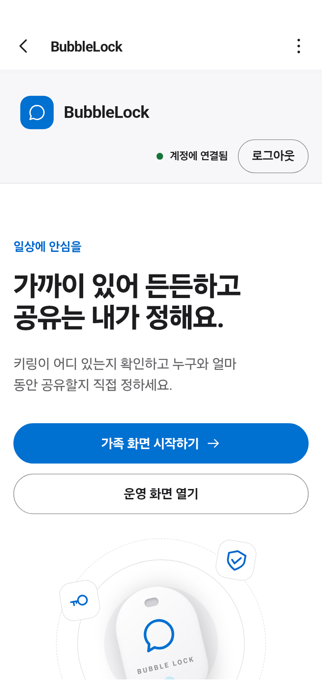
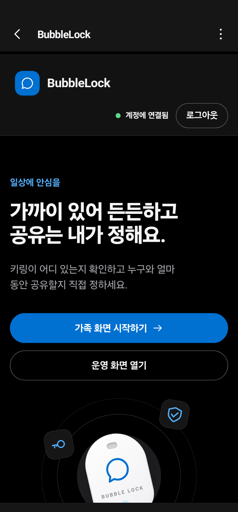

# 0.5.0 실제 단말 UI 기록

연결되고 잠금이 해제된 Android 14 휴대폰의 실제 설치 앱을 검사했다.
시험 대상은 최적화된 비디버그 Server Portal 프로필이며, 기존 데이터 위에
같은 workspace QA 서명으로 업데이트했다. 실제 BFF guardian 세션을 사용한다.

| 검사 | 결과 |
|---|---|
| [어두운 세로 화면](dark-portrait.json) | 48개 PASS, 56dp 상단바·48dp 제어·모바일 헤더 |
| [밝은 세로 화면](light-portrait.json) | 48개 PASS, 384dp에서 가로 넘침 없음 |
| [200% 글씨](large-text-200.json) | 48개 PASS, fontScale2 / WebView200 / 본문34px |
| [실제 탐색 터치](family-navigation.json) | 88개 PASS, 5탭·메뉴·배경 blank·RAM 경로 복원, 터치7회 |
| [오류 상태와 재시도](connection-recovery.json) | 33개 PASS, 통제된 HTTP503 콜백 후 실제 재시도 터치1회 |
| [최종 설치·정리](device-final-state.json) | 실제 APK SHA 대조·비디버그·시험 패키지 제거·표시 설정 복원 |
| [루트 통합 검증](workspace-verification.json) | 13개 단계 PASS |
| [범위와 잔여 조건](verification-summary.json) | 265개 검사·실제 터치8회, 제품 mutation0 |

가로 회전 시도는 앱의 실제 크기가 계속 384×722dp였으므로 가로 수용 결과에서
제외했다. native 기본 3탭의 별도 단말 수용, 다른 OS/GPU, 수동 화면 읽기
프로그램·배터리·실물 좌표·명령 동작은 이 UI 기록의 완료 범위가 아니다.

공개 PNG는 실제 앱에서 **공개 시작 화면만** 내부 `View.draw`로 렌더링한 것이다.
`FLAG_SECURE`를 해제하지 않았으며 OS 스크린샷·사람의 수동 조작 기록이 아니다.
WebView 합성 방식 때문에 native chrome 표현은 단말 화면과 다를 수 있다.
지도·실제 좌표·비밀번호 폼·계정 본문은 캡처하지 않았다.

| 밝은 화면 | 어두운 화면 |
|---|---|
|  |  |

[큰 글씨 공개 시작 화면](android-large-text-public.png)

초기 후보와 시험 도구 수정 전의 실패는 별도 비공개 로그에 보존했다. 단어의
실제 줄 수·JSON 배열의 요소값·정상 Activity 종료·쿠키 flush·렌더 완료를 확인하도록
시험 도구를 보완했다. 존재하지 않는 API로 실제 오류 UI를 유도하는 시도는
신뢰할 수 있는 fixture가 아니어서 최종 오류 판정에는 사용하지 않았다.

시험은 앱 데이터를 초기화하거나 전역 쿠키를 삭제하지 않았다. 단계별 입력은
시험 provider가 소비하면서 삭제하고 시험 패키지만 사용자0에서 제거했다.
기존 앱과 Secure Folder 사용자 프로필을 삭제하지 않았다. 서비스 신뢰와
현재 서명은 [산출물 기록](../../security/calm-console-20261119/release-artifacts.json)에 구분한다.
